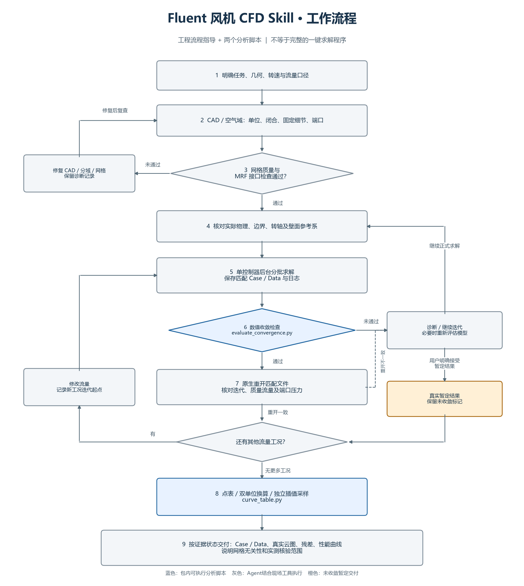

# Fluent Fan CFD Workflow Skill

Experimental engineering workflow guidance plus two read-only analysis helpers for fan CFD. **Not a turnkey solver, not an Ansys product, and not a validated accuracy benchmark.**

面向风机内部流场的实验性技能：规范 CAD/空气域、MRF接口检查、后台求解、收敛证据和性能曲线交付。它帮助Agent组织本地工具，不能代替有工程依据的建模和验证。



[完整流程图与Mermaid源](docs/workflow.md) · [适用范围](docs/portability.md) · [发布状态](PUBLICATION.md)

## 已提供与未提供

| 内容 | 当前状态 |
|---|---|
| SKILL.md与分阶段工程说明 | 已提供 |
| SST六残差/质量/压升稳定检查 | 已提供，可调阈值 |
| 已保存Data的残差/迭代交叉读取 | 一个已观察的HDF5布局，版本需核对 |
| 不同流量点整理、m³/h与m³/s换算 | 已提供 |
| 保形插值数据 | 可选，需要NumPy/SciPy；不是额外CFD结果 |
| 通用CAD提取、自动网格、Fluent启动执行器 | 未打包，需项目适配 |
| 通用云图与Native重开自动化 | 工作流说明，未打包通用驱动 |
| 多机型、Linux、多版本Fluent、实验精度 | 未验证 |

## 使用

按Agent宿主的技能安装说明，将本目录加入技能搜索位置；根目录的 `SKILL.md` 是入口。支持技能名称调用的宿主可使用 `$fluent-fan-cfd`。执行任何真实求解仍需合法安装的软件和用户授权的项目模型。

仅做JSON审查与点表导出时，两脚本使用Python标准库。当前实测为Windows、Python 3.14；其他平台/版本需运行测试后确认。

```sh
python scripts/evaluate_convergence.py examples/history.synthetic.json --output outputs/numerical-review.json
python scripts/curve_table.py examples/points.synthetic.json --mode provisional --output outputs/points.csv
python -m unittest discover -s tests -v
```

**示例数据为合成测试数据，不是仿真或实测。**

可选功能依赖：读取Native Data需要h5py；绘图插值采样需要NumPy和SciPy。按你的Python版本安装 `requirements-optional.txt` 中兼容版本，不要把不同Python ABI的本机依赖目录直接复制过去。

```sh
python scripts/curve_table.py examples/points.synthetic.json --mode provisional --output outputs/points.csv --smooth-output outputs/display.json --force
```

`provisional` 保留未验证状态。`final` 仅核对输入中 `converged`/`numerically_converged`、`native_reopen_verified` 和来源字段；**标志不等于原生证据**，脚本不会自动打开Fluent证明结果。

## 发布和许可

本候选包已去除本机案例路径、真实几何参数和试算结果，不含CAD、Case/Data、软件安装包或连接口令。发布者仍需确认对拟公开内容拥有相应权利。

尚未选择开源许可证，因此不能声称已按MIT或其他许可证开放授权。决定许可后在根目录补充真实 `LICENSE` 文件，见 [PUBLICATION.md](PUBLICATION.md)。

## 参考

- [OpenAI Docs：Skills](https://developers.openai.com/plugins/concepts/skills)
- [GitHub：Mermaid流程图](https://docs.github.com/en/get-started/writing-on-github/working-with-advanced-formatting/creating-diagrams)
- [GitHub：仓库许可证](https://docs.github.com/en/repositories/managing-your-repositorys-settings-and-features/customizing-your-repository/licensing-a-repository)
